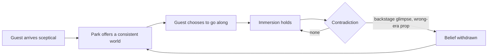

The phrase comes from Samuel Taylor Coleridge, who in *Biographia Literaria* (1817) described poetry that asks the reader for "that willing suspension of disbelief for the moment". The key word is *willing*. Guests are not fooled by a themed land; they agree to act as if it were real because the park makes that agreement easy and rewarding.

The park's side of the bargain is consistency. [Forced perspective](../story-experience/forced-perspective.md) works because nobody pulls out a tape measure. A pirate town with a drinks machine in the wrong era breaks the deal, which is the whole point of the [theme versus decoration](../story-experience/theme-vs-decoration.md) argument. Effects that are physical, as the [practical versus digital](../show-technology/practical-vs-digital-effects.md) debate notes, tend to ask less of the guest's goodwill than a screen does.

Suspension of disbelief also sets the bar for realism. Presence research shows people respond to a plausible world rather than a photoreal one, so a stylised animatronic that behaves consistently is accepted, while a near-human figure that moves wrongly tips into the [uncanny valley](../human-factors/uncanny-valley.md) and withdraws belief. The design question is not "is it real?" but "would anything here make a guest stop pretending?"

## Explore further
- `coleridge-biographia-literaria` — Biographia Literaria (Project Gutenberg)
- `slater-place-illusion-plausibility-2009` — Place illusion and plausibility can lead to realistic behaviour in immersive virtual environments
