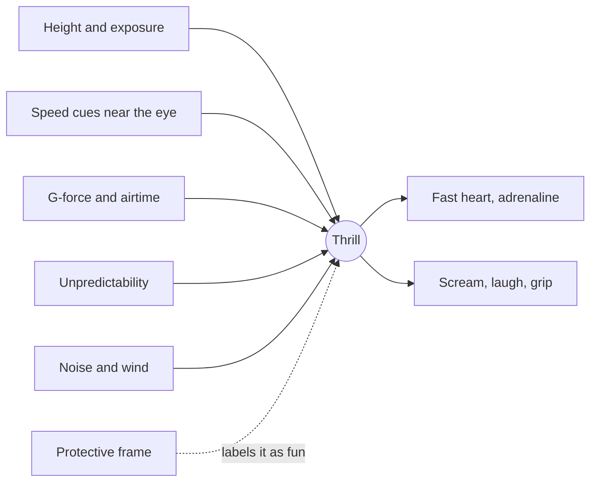

Thrill is a layered sensation. The sympathetic nervous system, the fight-or-flight circuit, reads a drop or a launch as a threat and floods the body with adrenaline. Heart rate jumps, pupils widen, palms sweat. On top of that physiology the mind adds a label, and inside a [protective frame](../human-factors/protective-frame.md) the label is "wonderful".

Designers feed the alarm system through several channels. [G-forces](../ride-engineering/g-force-basics.md) and airtime press and lift the body directly. Speed is felt mostly through the eyes, which is why [near objects in the periphery](../human-factors/peripheral-vision-and-speed.md) make 60 km/h feel like 100. Height and exposure, the view down from the crest, work on the fear of falling. Unpredictability adds the rest: a [launch](../ride-systems/launched-coasters.md) that fires without a countdown, or a dark-ride turn into something unexpected.

Not everyone wants the same dose. [Sensation seeking](../human-factors/sensation-seeking.md) varies widely, so a park needs rides along the whole scale, and the body has limits that [onset rate](../ride-engineering/jerk-and-onset-rate.md) and duration rules protect.

## Explore further
- `apter-dangerous-edge-1992` — The Dangerous Edge: The Psychology of Excitement
- `zuckerman-1979-sensation-seeking` — Sensation Seeking: Beyond the Optimal Level of Arousal
