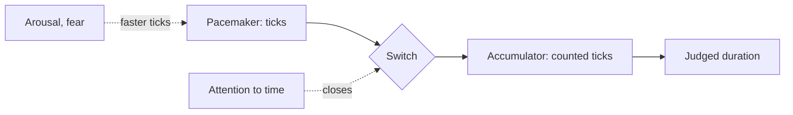

The standard model of felt time is a pacemaker, a switch and a counter. A pacemaker emits pulses; when attention is on time the switch closes and pulses are counted; the count is the felt duration. Sylvie Droit-Volet and Warren Meck reviewed what emotion does to this clock: fear and high arousal speed up the pacemaker, so frightening moments feel longer than they are. The second lever is attention. When the mind is absorbed in something else the switch flickers open, pulses are missed and time seems to fly; when there is nothing to do but wait, every tick is counted.

Both levers are in use all day in a park. A drop of three seconds feels like ten because [dread](../human-factors/anticipation-and-dread.md) has the pacemaker racing. A themed queue feels shorter because [occupied time](../human-factors/occupied-time.md) keeps the switch open. The gap between posted and felt waits in [perceived vs actual wait](../human-factors/perceived-vs-actual-wait.md) is mostly this clock.

Note the direction of the effects. In the moment, duration is stretched and shrunk; afterwards, [duration neglect](../human-factors/duration-neglect.md) means the remembered length barely matters. A [dispatch interval](../operations-business/dispatch-interval.md) that keeps the ride short can be fine for memory, provided the moments themselves feel full.

## Explore further
- `droit-volet-meck-2007-emotion-time` — How Emotions Colour Our Perception of Time
- `maister-psychology-of-waiting-lines` — The Psychology of Waiting Lines
