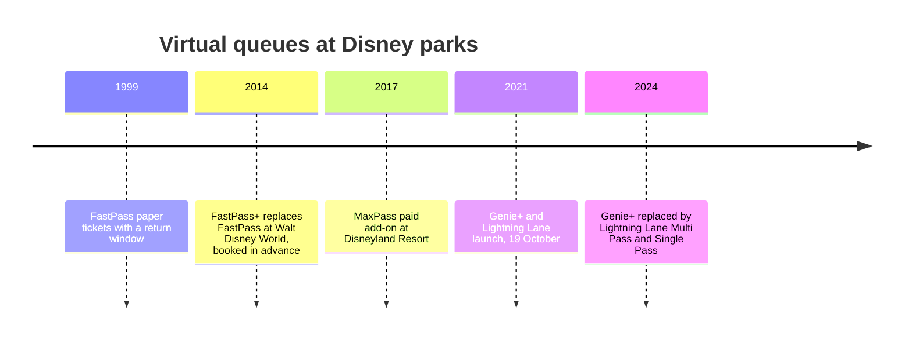

A virtual queue separates the *place in line* from the *body in line*. The guest registers, gets a return time, and comes back when called; meanwhile they shop, eat or ride something short. Maister's logic explains the appeal: the wait becomes known and finite, and the time is occupied however the guest chooses.

Disney's FastPass, introduced in late 1999, made the idea mainstream with paper tickets at the ride entrance. FastPass+ moved booking into an app and a wristband, MaxPass added a fee at Disneyland, and in October 2021 the Genie+ and Lightning Lane system made priority access a paid product, which is covered under [paid priority access](../human-factors/paid-priority-access.md). Legoland Windsor's Q-bot is the same idea from another operator.

The catch is physics. A virtual queue does not add capacity, it only decides who waits where, and every return-time guest is served ahead of someone in standby. Defunctland's FastPass history shows, with simulations, how standby waits lengthen as the virtual share grows. Operators manage the split against [capacity versus demand](../operations-business/capacity-vs-demand.md), feed it with [live wait data](../operations-business/wait-time-data-and-apps.md), and note that guests freed from lines spend more, lifting [per-capita spending](../operations-business/per-capita-spending.md). The [wearable](../operations-business/wearables-and-identity.md) that holds your place is the token of the [reservation era](../history/reservation-era.md).

## Explore further
- `wikipedia-disney-virtual-queues` — Virtual queue systems at Disney Parks
- `defunctland-fastpass-history` — Disney's FastPass: A Complicated History
- `wikipedia-queue-area` — Queue area
