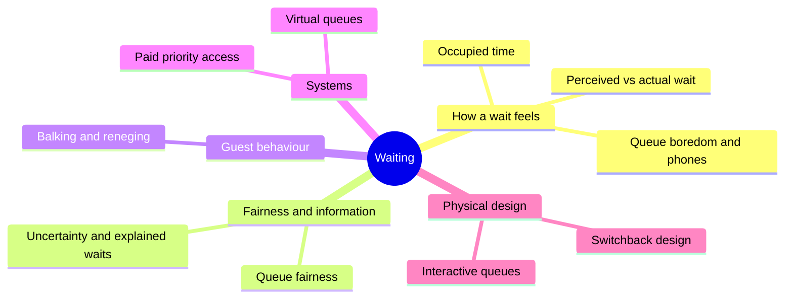

A typical park guest rides for well under an hour and waits for several. If the queue is miserable the day is miserable, however good the rides. David Maister's 1985 essay turned that into eight propositions that are still the working rules of queue design: occupied time feels shorter than unoccupied time; people want to get started; anxiety, uncertainty and lack of explanation all stretch a wait; unfair waits feel longer; people wait longer for things they value; and waiting alone is worse than waiting together.

Richard Larson added the social side: a queue is a small society with rules, and watching someone break them, a "slip" or a "skip", hurts more than the extra minutes do. That tension sits under every [paid priority](../human-factors/paid-priority-access.md) product.

The cards below move from perception ([perceived vs actual wait](../human-factors/perceived-vs-actual-wait.md), [occupied time](../human-factors/occupied-time.md)) through behaviour ([balking and reneging](../human-factors/balking-and-reneging.md)) to systems and physical design. They pair with the operations land, where [queueing theory](../operations-business/queueing-theory.md) and [capacity versus demand](../operations-business/capacity-vs-demand.md) set how long the line really is, and with the story land's [queue storytelling](../story-experience/queue-storytelling.md).

## Explore further
- `maister-psychology-of-waiting-lines` — The Psychology of Waiting Lines
- `larson-1987-queue-social-justice` — Perspectives on Queues: Social Justice and the Psychology of Queueing
