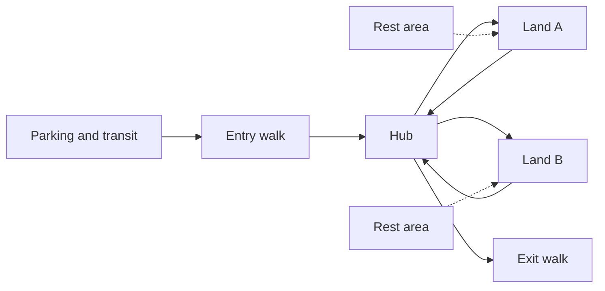

A theme park day is a long hike in disguise. Guests walk from distant parking, across the entry plaza, between lands and through queues, almost all on concrete or asphalt. The exact distance varies by park and by guest, and published step counts are mostly anecdotal, so treat specific mileage claims as unverified. What is certain is that by late afternoon feet hurt, tempers shorten and spending drops.

Layout is the main cause and the main cure. A [hub-and-spoke](../masterplanning/hub-and-spoke.md) plan keeps every land a short walk from a central node and avoids the long back-tracks of a linear park. [People movers](../ride-systems/monorail-and-people-movers.md) and trams absorb the [parking](../masterplanning/parking-and-transit.md) walk. Fruin's pedestrian work gives planners walking speeds and level-of-service grades, so a crowded path that forces shuffling can be widened before it exhausts everyone on it.

Rest matters as much as distance. [Rest areas](../masterplanning/rest-areas.md) with shade and seating near big-ride exits let groups regroup and recover. Benches along paths, not just in plazas, let older guests stop without leaving the flow. Operators notice that well-rested guests stay longer, which links directly to [length of stay](../operations-business/length-of-stay.md).

## Explore further
- `fruin-pedestrian-planning-1971` — Pedestrian Planning and Design (book)
- `fhwa-fruin-walkway-los` — FHWA: Pedestrian level of service tables adapted from Fruin
