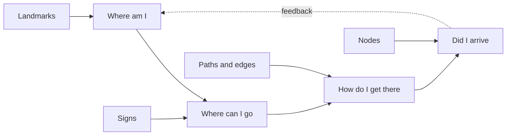

Wayfinding is the quiet skill of knowing where you are and how to reach where you want to be. Kevin Lynch called the quality that makes this easy **imageability**: a place is legible when its paths, edges, districts, nodes and landmarks are distinct enough to build a mental map from.

Theme parks are wayfinding machines. Disneyland's castle is a [weenie](../story-experience/weenies.md), a tall visual magnet that pulls guests down Main Street and gives them a fixed reference from anywhere in the park. A [hub-and-spoke](../masterplanning/hub-and-spoke.md) layout turns the hub into a node where every decision resets. Distinct themed lands act as districts, so a guest in Frontierland never confuses it with Tomorrowland.

Good wayfinding reduces the number of choices a tired guest must make, which helps with [decision fatigue](../human-factors/decision-fatigue.md). When it fails, guests stop, cluster at junctions, and cut [desire lines](../human-factors/desire-lines.md) through planting. Signs are the last resort, not the first: a well-shaped space should explain itself before [signage](../design-process/signage-and-graphics.md) has to.

## Explore further
- `lynch-image-of-the-city` — The Image of the City (book)
- `wikipedia-desire-path` — Desire path
