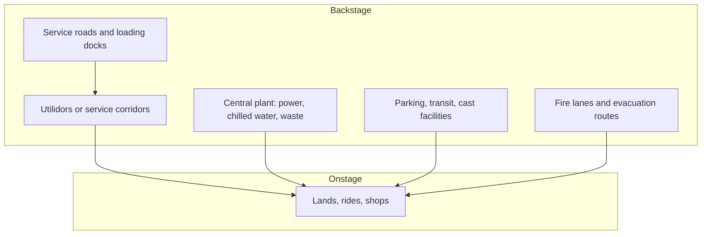

Backstage and infrastructure is the half of the masterplan guests are not meant to notice. A theme park is a small city: it needs power, chilled water, sewage, waste removal, deliveries, staff changing rooms, fire lanes and a way to get tens of thousands of cars in and out. The planning trick is to provide all of it while keeping it invisible, so the fiction onstage survives.

The organising idea is [onstage and backstage](../masterplanning/onstage-backstage.md), a theatre metaphor Disney made literal. Magic Kingdom's [utilidors](../masterplanning/utilidors.md) run beneath the park so costumes and deliveries never cross a land. [Service roads](../masterplanning/service-roads.md) ring the site behind [the berm](../story-experience/the-berm.md). A [central plant](../masterplanning/utilities-and-central-plant.md) feeds the whole resort, and [parking and transit](../masterplanning/parking-and-transit.md) is sized to the design day. [Emergency access](../masterplanning/emergency-access.md) must thread through all of it.

Every one of these systems protects [suspension of disbelief](../human-factors/suspension-of-disbelief.md) by removing [operational intrusion](../human-factors/operational-intrusion.md): no forklifts on Main Street, no bins by the castle.

## Explore further
- `wikipedia-disney-utilidor-system` — Disney utilidor system (Wikipedia)
- `wikipedia-reedy-creek` — Reedy Creek Improvement District (Wikipedia)
- `wikipedia-transportation-and-ticket-center` — Transportation and Ticket Center (Wikipedia)
