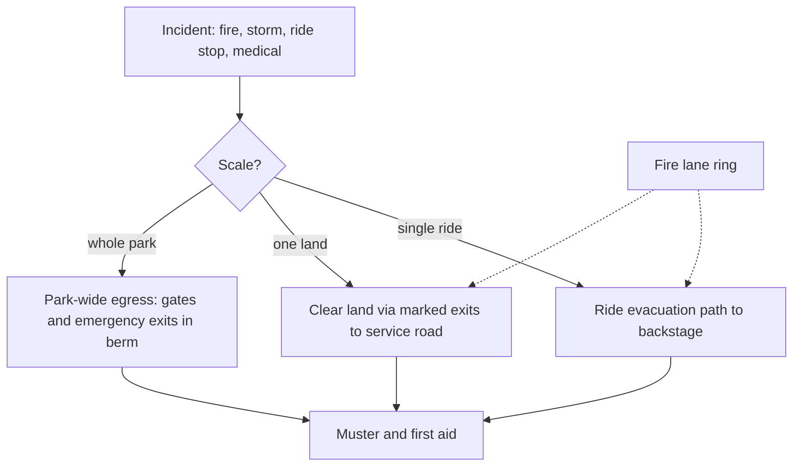

Emergency access is the backstage system nobody wants to use. A masterplan must guarantee two things: that fire engines and ambulances can reach any point in the park quickly, and that every guest can get out if the park, a land or a single ride has to be cleared. Both are drawn before the theming.

In the United States the governing rules come largely from NFPA 101, the Life Safety Code, which sets means-of-egress widths and exit counts for assembly occupancies, and from local building codes. Walt Disney World went further by writing its own EPCOT Building Codes and running its own fire department through the Reedy Creek district, now the Central Florida Tourism Oversight District. Most parks instead work with the city fire marshal, who wants a fire lane ring and gates in the berm.

Planning rules follow. Paths that double as egress are sized above their everyday [level of service](../masterplanning/level-of-service.md) so a stalled parade crowd can still move, and [pinch points](../masterplanning/pinch-points.md) are the first thing a fire review flags. Each ride needs an [evacuation route](../safety-standards/emergency-stop-and-evacuation.md) from any stop position to backstage. [Weather policies](../safety-standards/weather-policies.md) add shelter-in-place plans for lightning, and trained [crowd management](../operations-business/crowd-management.md) turns the plan into behaviour.

## Explore further
- `wikipedia-nfpa-101-life-safety-code` — Life Safety Code, NFPA 101 (Wikipedia)
- `wikipedia-reedy-creek` — Reedy Creek Improvement District (Wikipedia)
- `gkstill-phd-crowd-dynamics-ch3` — Crowd Dynamics, PhD chapter 3 (Keith Still)
