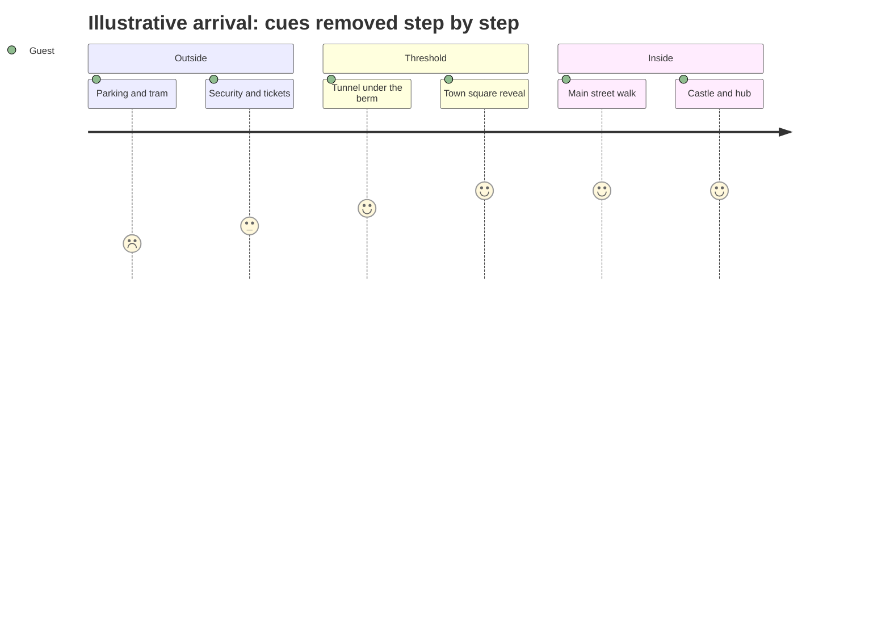

The entry sequence is the choreography of arrival. Planners treat it like the opening scene of a film: parking, tram, security, turnstiles, a compression point and then a reveal. Each step strips away a piece of the outside world so that by the first land the guest has accepted the fiction, which is what psychologists call [suspension of disbelief](../human-factors/suspension-of-disbelief.md).

Magic Kingdom's version is the most elaborate. Guests leave their car more than a mile away, cross Seven Seas Lagoon by monorail or ferry, pass under the railroad berm and emerge into Town Square with Cinderella Castle framed at the end of Main Street. The tunnel is a textbook [threshold](../story-experience/thresholds-and-portals.md), and the scaled-down upper storeys use [forced perspective](../story-experience/forced-perspective.md) to make the walk feel grander. Epic Universe compresses the same idea into a single gate: guests pass through a machine called Chronos and arrive in Celestial Park, where four portals wait.

The sequence also has operational jobs. It is where bag checks, ticketing and [opening procedures](../operations-business/opening-and-closing-procedures.md) happen, and it must swallow the morning rush without the queue becoming the first impression.

## Explore further
- `touringplans-urban-designer-main-street` — An Urban Designer Looks at Main Street
- `discoveruniversal-epic-universe` — Universal Epic Universe: everything we know
- `hench-designing-disney` — Designing Disney (John Hench)
