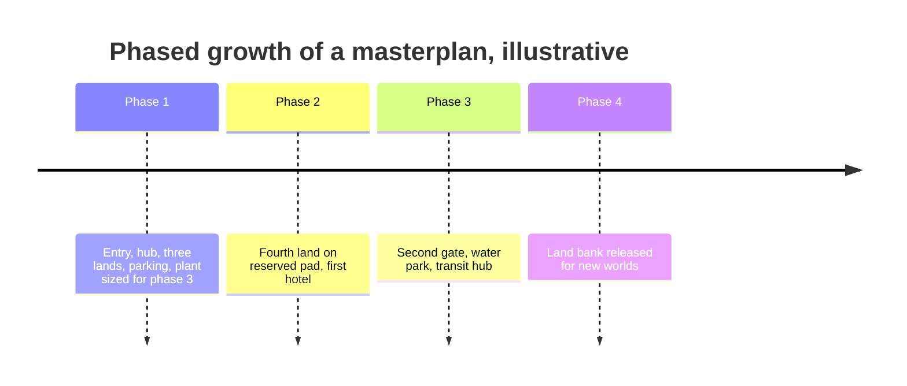

No park opens finished. A masterplan is a sequence of phases, each one a complete park on opening day and a step toward a bigger one. The classic mistakes are fencing the park too tightly and under-sizing the plant, car park and service road for the eventual build-out. Peter Alexander lists room for expansion as a core element of any plan.

The industry's current showcase is Universal Epic Universe: about 110 acres of park sitting inside a 750-acre site south of Orlando, with the rest held for hotels, further gates and future worlds. Tokyo DisneySea opened in 2001 with seven ports of call and added its eighth, Fantasy Springs, in June 2024 on land reserved from the start. Europa-Park has added country-themed areas since 1975, growing from 16 hectares to a resort of about 95. Disney's DisneylandForward plan in Anaheim shows the opposite case: a landlocked park reshuffling development on land it already owns.

Phasing is a financial tool as much as a spatial one. [Capital budgets](../operations-business/capital-budgets.md) spread across years, each phase follows the [phase timeline](../design-process/phase-timeline.md) of a new attraction, and old rides retire in the [ride lifecycle](../operations-business/ride-lifecycle.md) to free pads. The land bank is fixed at [site selection](../masterplanning/site-selection.md).

## Explore further
- `wikipedia-epic-universe` — Universal Epic Universe (Wikipedia)
- `wikipedia-tokyo-disneysea` — Tokyo DisneySea (Wikipedia)
- `wikipedia-europa-park` — Europa-Park (Wikipedia)
- `themedattraction-master-planning` — Theme Park Master Planning (Peter Alexander)
