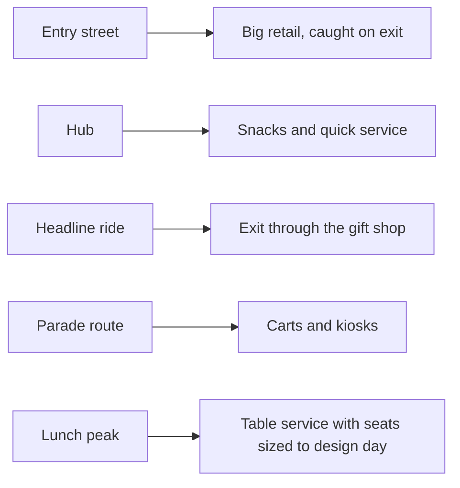

Food and retail placement is where masterplanning meets the till. Shops and restaurants are sized from the [design day](../masterplanning/design-day.md), since PGAV's time-budget method reserves part of every guest hour for eating and buying, and seats, counters and kitchens must match that demand at the lunch peak. Then they are positioned on the flow.

A few placements recur across the industry. The entry street is lined with the largest shops because every guest walks it twice, and the exit walk is when wallets open. Rides exit through a themed store while the thrill is fresh, a move that converts [souvenirs](../human-factors/souvenirs-and-memory-cues.md) into memory cues. Quick service clusters near the hub and at land boundaries so nobody is more than a short walk from food, which blunts [hunger](../human-factors/hunger-and-hydration.md) complaints. Carts and kiosks line parade routes where crowds stand for an hour.

The craft is to do this without hurting the story. A themed counter can be [choice architecture](../human-factors/choice-architecture.md) and set dressing at once, and a restaurant interior is a [servicescape](../sensory-environment/servicescape.md) that extends the land. Done well it raises [per-capita spending](../operations-business/per-capita-spending.md); done badly, guests feel sold to.

## Explore further
- `pgav-designing-the-day` — Designing the Day (PGAV Destinations)
- `themedattraction-master-planning` — Theme Park Master Planning (Peter Alexander)
- `hench-designing-disney` — Designing Disney (John Hench)
