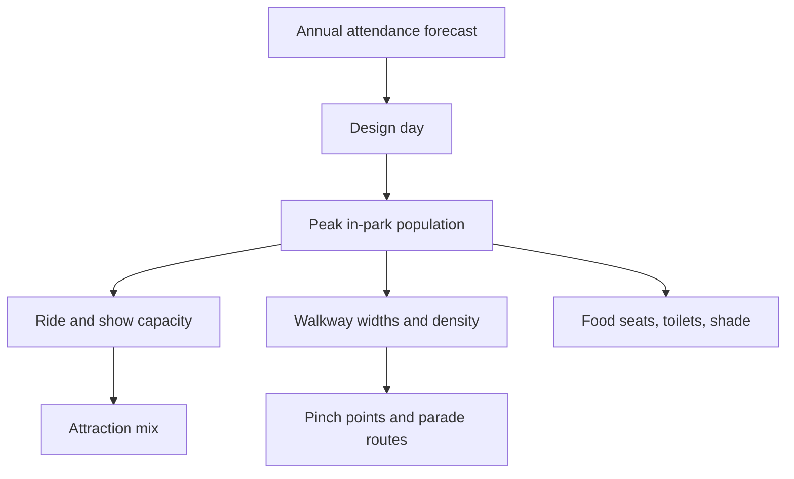

Guest flow and capacity is the arithmetic side of masterplanning. A park is a machine for processing a crowd: so many people arrive, spread out, ride, eat, watch a parade, and leave. If the machine is undersized, queues balloon and paths jam; if oversized, the owner paid for concrete nobody walks on.

Everything starts from [capacity planning](../masterplanning/capacity-planning.md), which turns an attendance forecast into a [design day](../masterplanning/design-day.md) and a peak in-park population. That number drives the [attraction mix](../masterplanning/attraction-mix.md), the hourly [throughput](../operations-business/throughput-and-queueing.md) each ride must deliver, and the physical width of every path, judged by [level of service](../masterplanning/level-of-service.md). Planners then study [guest flow patterns](../masterplanning/guest-flow-patterns.md) over the day, hunt for [pinch points](../masterplanning/pinch-points.md), and place [food and retail](../masterplanning/food-and-retail-placement.md), [rest areas](../masterplanning/rest-areas.md) and [parade routes](../masterplanning/parade-and-show-crowds.md) where the crowd will actually be.

The human side matters as much as the maths: [crowd behaviour](../human-factors/crowd-behavior.md) is predictable enough to model but never fully obedient, so good plans leave slack.

## Explore further
- `pgav-designing-the-day` — Designing the Day (PGAV Destinations)
- `themedattraction-master-planning` — Theme Park Master Planning (Peter Alexander)
- `fruin-pedestrian-planning-1971` — Pedestrian Planning and Design (Fruin)
