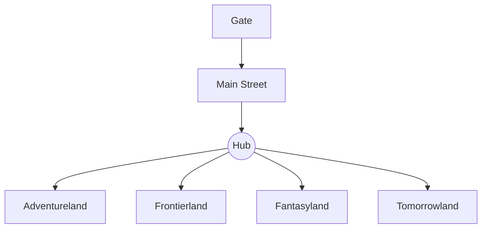

*Photo: Orange County Archives, CC BY 2.0, via Wikimedia Commons — [source](https://commons.wikimedia.org/wiki/File:Disneyland_aerial_view,_1962_-_Flickr_-_Orange_County_Archives.jpg)*

Hub-and-spoke is the layout Disneyland introduced in 1955: one gate, one main street, a central plaza, and themed lands reaching out from it like spokes. Walt Disney wanted a single entrance so the park could count and control its crowd, and a central plaza so nobody got what he called "museum feet" from walking too far. From the hub you can see several lands at once, so [wayfinding](../human-factors/wayfinding.md) needs no map.

The hub also solves a story problem. The [central icon](../masterplanning/central-icon.md) stands at the centre, acting as the biggest [weenie](../story-experience/weenies.md) in the park, and each spoke begins with a [threshold](../story-experience/thresholds-and-portals.md) into a new world. Magic Kingdom (1971) copied the plan with Cinderella Castle at the centre, and Universal's Epic Universe (2025) revived it with Celestial Park as the hub and four portal worlds as spokes.

The cost is congestion: the hub becomes the park's busiest [pinch point](../masterplanning/pinch-points.md) at parade and fireworks time, which is why later parks added cut-through paths between adjacent lands.

## Explore further
- `wikipedia-disneyland` — Disneyland (Wikipedia)
- `touringplans-urban-designer-main-street` — An Urban Designer Looks at Main Street
- `wikipedia-epic-universe` — Universal Epic Universe (Wikipedia)
- `hench-designing-disney` — Designing Disney (John Hench)
