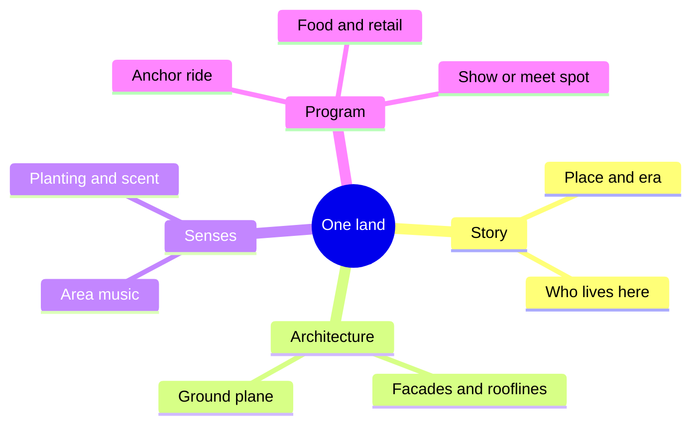

A land, or themed zone, is a district of the park where everything agrees: buildings, paving, planting, music, costumes, menus and rides all describe the same place and time. The guest should be able to stand anywhere inside it and see nothing from another story. That is why land design belongs to masterplanning rather than ride design; the boundary of a land is a planning line drawn before the first facade is sketched.

Good lands are built like small cities. Each has an anchor attraction, a gathering space, a reason to eat there, and enough secondary content to hold a crowd for an hour or two. The architecture carries [themed storytelling](../story-experience/themed-storytelling.md), with [buildings as characters](../story-experience/architecture-as-character.md) and [area music](../sensory-environment/area-music.md) completing the picture. Universal's Wizarding World of Harry Potter raised the bar with a fully enclosed village; Epic Universe pushes further, sealing each world behind its own portal. Europa-Park organises its zones by European country, proving a theme can be a geography as easily as a film.

Sealing a land increases [presence](../human-factors/presence.md) but costs legibility, so planners balance immersion against the [transitions](../masterplanning/land-transitions.md) that let guests move on.

## Explore further
- `hench-designing-disney` — Designing Disney (John Hench)
- `mappedin-epic-universe` — Epic Universe map and layout analysis
- `wikipedia-europa-park` — Europa-Park (Wikipedia)
