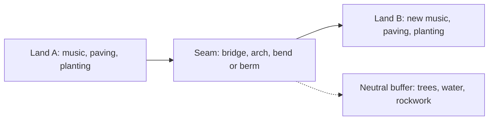

A transition is the few metres where one land ends and the next begins. Done badly, two stories shout over each other; done well, guests never notice they crossed a line. John Hench described the technique as a gradual blend, so the eye and ear are led rather than jolted.

Planners use a small toolkit. A bend in the path or a bridge hides the next land until the last moment and keeps [sightlines](../story-experience/sightlines.md) clean. Speakers are zoned so [area music](../sensory-environment/audio-zoning.md) fades out before the next loop fades in. Paving changes under the feet, a trick called [ground plane storytelling](../sensory-environment/ground-plane-storytelling.md), and [planting](../sensory-environment/planting-design.md) shifts from, say, tropical to alpine. At Disneyland, Adventureland's jungle blends into Frontierland's river through shared water and timber; at Epic Universe the seam is a sealed portal, which gives maximum contrast but no blending at all.

Transitions are also where backstage leaks. Service gates, bathrooms and first-aid often hide in the seam because neither land has to own them. The risk is [breaking immersion](../human-factors/breaking-immersion.md) if a cast member in the wrong costume crosses the boundary, which is the problem [utilidors](../masterplanning/utilidors.md) were built to solve.

## Explore further
- `hench-designing-disney` — Designing Disney (John Hench)
- `mappedin-epic-universe` — Epic Universe map and layout analysis
- `wikipedia-disney-utilidor-system` — Disney utilidor system (Wikipedia)
