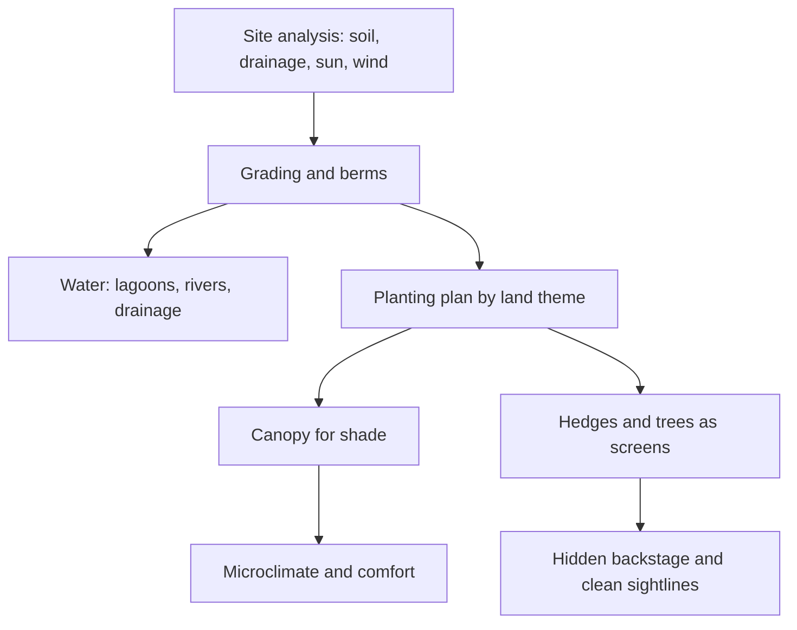

Landscape architecture is the discipline that shapes the ground between the rides, and in a theme park that ground is most of what guests see. It covers grading, drainage, lagoons and rivers, berms, paving and above all planting. Falcon's Creative Group starts a masterplan from topography, soil, drainage, wind and sun: landscape thinking before theming.

Disneyland set the standard. In 1954 Walt Disney asked horticulturist Bill Evans and his brother Jack to landscape the park, and in about a year they turned 80 acres of Anaheim orange groves into themed grounds, including a two-acre jungle for the Jungle Cruise built from mature trees moved in from across Southern California. Evans later became director of landscape architecture. The planted [berm](../story-experience/the-berm.md) around the park is landscape doing a storytelling job: it hides the city and carries the railroad.

Today's landscape plan sets the [planting design](../sensory-environment/planting-design.md) palette for each land so that a jungle and an alpine village can be neighbours, provides the canopy that drives [shade and microclimate](../sensory-environment/shade-and-microclimate.md), screens backstage, and softens the hardscape so guests feel the pull of [biophilia](../sensory-environment/biophilia.md). Epic Universe's designers made gardens and water the centre of the park for exactly this reason.

## Explore further
- `d23-bill-evans` — Bill Evans, Disney Legend (D23)
- `wikipedia-disneyland` — Disneyland (Wikipedia)
- `falcons-master-planning-process` — Master Planning Process (Falcon's Creative Group)
