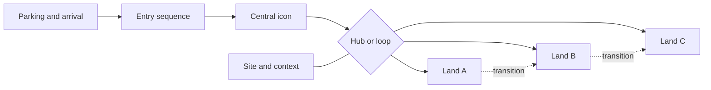

Park structure is the skeleton of a theme park: where you arrive, what pulls you forward, how the themed zones connect, and what the site itself allows. Planners usually settle it before any single ride is drawn, because the structure sets walking distances, sightlines and crowd behaviour for decades.

The classic answer is Disneyland's [hub-and-spoke](../masterplanning/hub-and-spoke.md): one entrance, a [central icon](../masterplanning/central-icon.md) as the visual magnet, and lands fanning out from a plaza. Universal's parks around a lagoon show the other family, the [loop and linear layouts](../masterplanning/loop-and-linear-layouts.md). Either way the plan is read through a staged [entry sequence](../masterplanning/entry-sequence.md), divided into [themed lands](../masterplanning/land-design.md), stitched together with careful [transitions](../masterplanning/land-transitions.md), and shaped by [site selection](../masterplanning/site-selection.md).

Structure is also psychology. Clear structure supports [wayfinding](../human-factors/wayfinding.md) and lowers [walking fatigue](../human-factors/walking-fatigue.md); strong icons act as [weenies](../story-experience/weenies.md) that make a map unnecessary.

## Explore further
- `themedattraction-master-planning` — Theme Park Master Planning (Peter Alexander)
- `falcons-master-planning-process` — How to Design a Theme Park: Master Planning Process
- `hench-designing-disney` — Designing Disney (John Hench)
