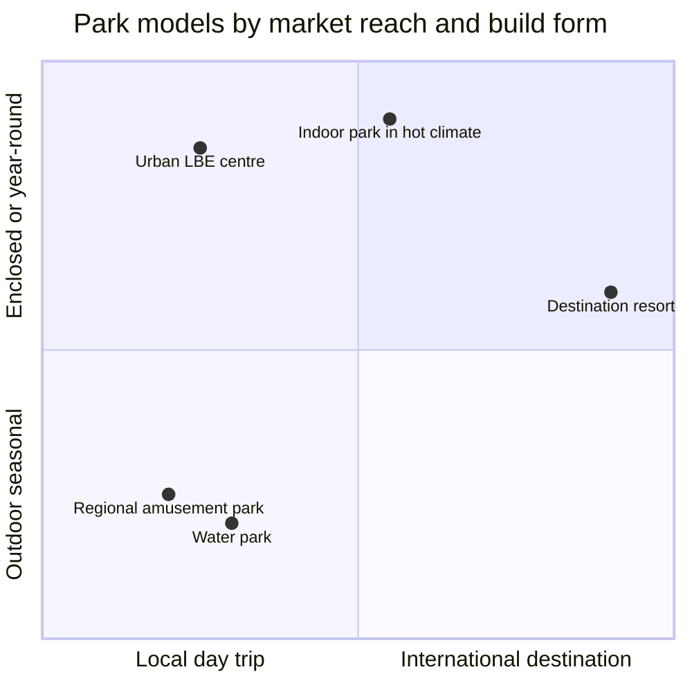

Park types are the business models behind the maps. Before deciding on a hub or a loop, an owner decides what kind of park this is: who it serves, how far they travel, how long they stay, how many days a year it can open, and whether it is one gate or a whole resort. Each answer sets the budget, the attraction mix and the land needed.

The first split is [regional versus destination](../masterplanning/regional-vs-destination.md): a drive-in park that lives on repeat visits from a few hours away, or a fly-in resort that sells multi-day stays. Destination parks grow into [integrated resorts](../masterplanning/resort-integration.md) with hotels, water parks and shopping, built in stages through [expansion and phasing](../masterplanning/expansion-and-phasing.md). Climate adds another axis: [indoor parks](../masterplanning/indoor-parks.md) for deserts and winters, [water parks](../masterplanning/water-parks.md) for summers. The TEA Global Experience Index, the annual attendance report, is the yardstick for all of them; its 2024 edition counted almost 246 million visits across the top 25 theme parks.

The type chosen feeds [attendance modelling](../operations-business/roi-and-attendance-modeling.md), target [length of stay](../operations-business/length-of-stay.md), and where the project sits in the wider [industry structure](../operations-business/industry-structure.md).

## Explore further
- `tea-global-experience-index-2024` — Official Release of the 2024 TEA Global Experience Index
- `teaconnect-theme-museum-index` — What is the Theme Index and Museum Index? (TEA)
- `aecom-theme-index` — Theme Index and Museum Index archive (AECOM)
- `openlibrary-walts-revolution` — Walt's Revolution! By the Numbers
