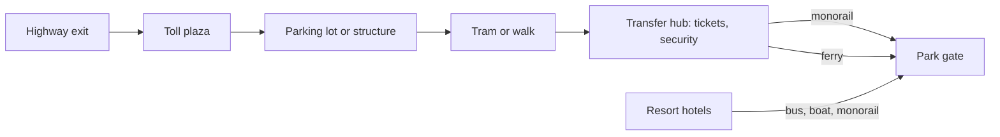

Parking and transit decide a guest's first and last twenty minutes, and they consume more land than the park itself. Planners size the car park from the [design day](../masterplanning/design-day.md): guests divided by people per car, plus buses and staff. Magic Kingdom's main lot at the Transportation and Ticket Center holds 12,156 cars, and the park sits more than a mile away across Seven Seas Lagoon, so arrival is a chain of tram, then monorail or ferry. That distance was a choice; it makes the commute the opening act of the [entry sequence](../masterplanning/entry-sequence.md) and keeps asphalt out of the castle view.

The transfer point is also where security screening and ticketing happen, so a crowd arriving by car, bus or hotel boat reaches the gate already checked. [Monorails and people movers](../ride-systems/monorail-and-people-movers.md) are attractions, but their real job is throughput: moving tens of thousands of people in the rope-drop hour and again at closing.

Multi-park resorts add a transit web between hotels and gates, which is central to [resort integration](../masterplanning/resort-integration.md). Urban parks build parking structures and lean on public transport. In every case, a long walk from car to gate adds to [walking fatigue](../human-factors/walking-fatigue.md) before the day has begun.

## Explore further
- `wikipedia-transportation-and-ticket-center` — Transportation and Ticket Center (Wikipedia)
- `wikipedia-magic-kingdom` — Magic Kingdom (Wikipedia)
- `wikipedia-walt-disney-world` — Walt Disney World (Wikipedia)
