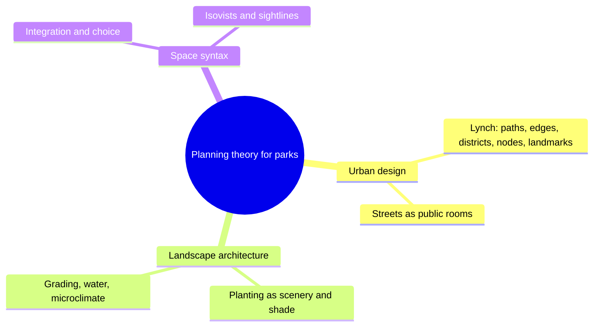

Planning theory is the borrowed thinking behind park layout. Theme park masterplanning is young, but it sits on three older disciplines, and the best planners read them fluently.

From urban design comes legibility. Kevin Lynch's The Image of the City (1960) showed that people navigate by paths, edges, districts, nodes and landmarks, which maps neatly onto a park's walkways, berms, lands, hubs and castles. These [urban planning parallels](../masterplanning/urban-planning-parallels.md) explain why Main Street works like a town's high street and why a hub is a civic square. From [landscape architecture](../masterplanning/landscape-architecture.md) comes the ground itself: grading, drainage, shade and planting, the craft Bill Evans used to turn an orange grove into Disneyland in a year. From Bill Hillier's [space syntax](../masterplanning/space-syntax.md) comes a way to predict movement from the geometry of a path network before anything is built.

Together they link the masterplan to [wayfinding](../human-factors/wayfinding.md) and [environmental psychology](../sensory-environment/environmental-psychology.md), and they are the rule set behind emerging [procedural layout](../ai-future/procedural-layout.md) tools. Game designers will recognise the same ideas in [level design](../story-experience/level-design-parallels.md).

## Explore further
- `openlibrary-lynch-image-of-the-city` — The Image of the City (Kevin Lynch)
- `openlibrary-hillier-social-logic-of-space` — The Social Logic of Space (Hillier and Hanson)
- `d23-bill-evans` — Bill Evans, Disney Legend (D23)
