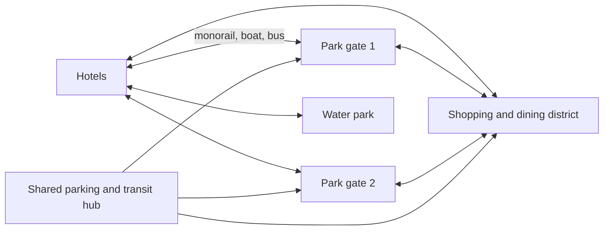

Resort integration is the step from a park to a place to stay. Instead of one gate beside a car park, the masterplan lays out several gates, hotels, a water park, golf, a shopping district and the transit that ties them together, so that a guest's whole holiday happens on the property. Walt Disney bought about 27,000 acres in Florida partly because Disneyland's edges had been swallowed by motels he did not own; at Walt Disney World two hotels opened with Magic Kingdom in 1971, linked by monorail and boat.

The plan has to think in days, not hours. Hotels are sited so a tired family can be back in the room in minutes, which is why Universal's Helios Grand Hotel has its own portal straight into Epic Universe's Celestial Park. A central transit hub, like Disney's Transportation and Ticket Center, handles parking, tickets and security once for everyone. A dining and retail district open to non-ticket holders keeps spending flowing in the evening.

Integration pays through [length of stay](../operations-business/length-of-stay.md) and [per-capita spending](../operations-business/per-capita-spending.md), and it enables resort-wide systems such as [wearable identity](../operations-business/wearables-and-identity.md) that work from hotel door to ride queue. Europa-Park's six hotels show the same logic at regional scale.

## Explore further
- `wikipedia-walt-disney-world` — Walt Disney World (Wikipedia)
- `wikipedia-epic-universe` — Universal Epic Universe (Wikipedia)
- `wikipedia-europa-park` — Europa-Park (Wikipedia)
- `wikipedia-transportation-and-ticket-center` — Transportation and Ticket Center (Wikipedia)
