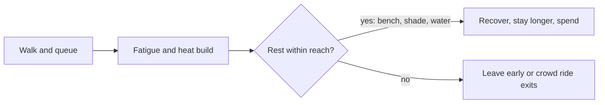

Rest areas are the planned pauses in a park day: benches, shade structures, trees, misters, water fountains and quiet corners. They look like afterthoughts and are anything but. A guest who cannot sit down leaves early, so seating and shade are part of [capacity](../masterplanning/capacity-planning.md), not decoration.

Walt Disney worried about "museum feet", the ache of walking too long, and the compact hub plan was partly his cure. Landscape architect Bill Evans then filled Disneyland with mature trees so that the park had shade on opening day. Planners now map the sun path and aim for shaded seating near queues, food and parade routes, where people stand longest. Environmental psychology adds a rule of thumb: people rest where they can see without being in the stream, a pattern called [prospect and refuge](../sensory-environment/prospect-refuge.md).

Hot climates push the idea to extremes. Ferrari World in Abu Dhabi put most of its park under one roof, turning the whole site into a rest area. Elsewhere, [thermal comfort](../human-factors/thermal-comfort.md) drives misting fans and air-conditioned shops along the route, and [quiet rooms](../human-factors/sensory-guides-and-quiet-rooms.md) give neurodivergent guests a place to reset. Every rest area bought back lowers [walking fatigue](../human-factors/walking-fatigue.md) and lengthens the stay.

## Explore further
- `hench-designing-disney` — Designing Disney (John Hench)
- `d23-bill-evans` — Bill Evans, Disney Legend (D23)
- `wikipedia-ferrari-world` — Ferrari World Abu Dhabi (Wikipedia)
