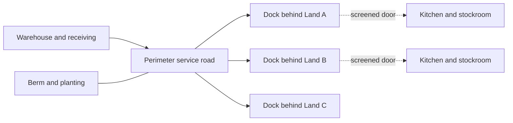

Service roads are how a park gets fed. Food, merchandise, spare parts, costumes, rubbish and show scenery all move by truck, and in most parks they move on a perimeter road that runs behind the lands, outside the guest area. Each land backs onto the road through a screened dock, so a kitchen can be restocked while the restaurant front stays in character. The road also carries staff shuttles, fire engines and, during construction, the cranes for a new ride.

Disneyland's planted [berm](../story-experience/the-berm.md) hides this ring as well as the outside world, and the first rule of a new masterplan is still to reserve a backstage road corridor before the lands are shaped. Falcon's Creative Group describes layering utilities and access under the creative plan, much as a city sequences roads before buildings. Where a site is too tight for a full ring, deliveries are timed to [opening and closing procedures](../operations-business/opening-and-closing-procedures.md), with trucks rolling onstage only before gates open.

The alternative is Magic Kingdom's [utilidors](../masterplanning/utilidors.md), a road system moved indoors and under the park. Either way the goal is the same: no [visual intrusion](../human-factors/visual-intrusion.md) from a pallet jack, and quick access for [parts](../operations-business/spare-parts-and-obsolescence.md) and [show installs](../design-process/show-install.md).

## Explore further
- `wikipedia-disney-utilidor-system` — Disney utilidor system (Wikipedia)
- `falcons-master-planning-process` — Master Planning Process (Falcon's Creative Group)
- `wikipedia-disneyland` — Disneyland (Wikipedia)
