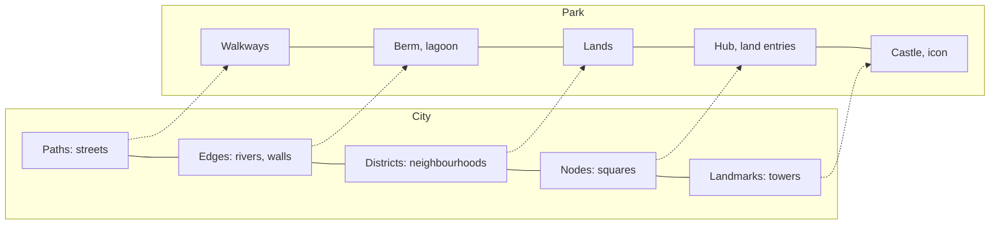

A theme park is a city with the problems edited out, and urban planning gives the clearest language for reading one. Kevin Lynch asked residents to sketch their cities from memory and found five elements doing all the work: paths, edges, districts, nodes and landmarks. Swap in walkways, berms, lands, hubs and the castle and you have a theme park masterplan. A park with strong versions of all five is legible, which is the goal of [wayfinding](../human-factors/wayfinding.md) design and the reason [landmarks and nodes](../human-factors/landmarks-and-nodes.md) get so much attention.

Urban planner Sam Gennawey reads Magic Kingdom's Main Street as a textbook town: Town Square as the civic core with City Hall, a shopping street framed to a terminating landmark, and a plaza where districts meet. Walt Disney's original EPCOT was pitched as a working city, and the Reedy Creek Improvement District gave his company municipal powers over roads, utilities and building codes.

The borrowing runs both ways. Planners of real downtowns study parks for [signage hierarchy](../human-factors/signage-hierarchy.md), street scale and the [servicescape](../sensory-environment/servicescape.md) of a well-kept public room, while park designers lean on [space syntax](../masterplanning/space-syntax.md) and other city tools to test their plans.

## Explore further
- `openlibrary-lynch-image-of-the-city` — The Image of the City (Kevin Lynch)
- `touringplans-urban-designer-main-street` — An Urban Designer Looks at Main Street
- `wikipedia-reedy-creek` — Reedy Creek Improvement District (Wikipedia)
