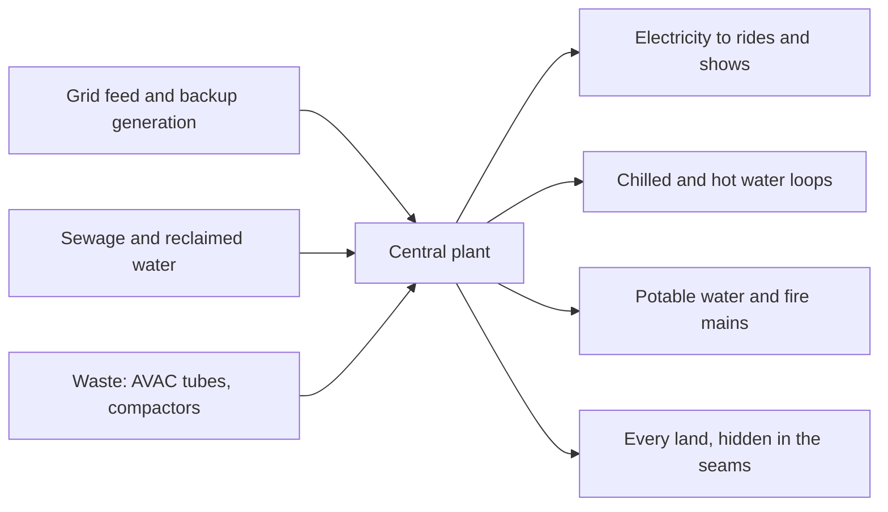

A theme park consumes energy like a town: ride motors, show lighting, kitchens, and above all air conditioning in hot climates. Rather than scatter plant rooms through the lands, planners usually build a central plant backstage that makes chilled water, hot water and sometimes electricity, then pipe it to every building through the service corridors. Centralising the plant keeps noise and exhaust off stage and lets engineers run [preventive maintenance](../operations-business/preventive-maintenance.md) without entering a land.

Walt Disney World shows the full-city version. The Reedy Creek Improvement District, created by Florida law in 1967 and renamed the Central Florida Tourism Oversight District in 2023, gave the resort its own utility powers: electricity generation and distribution, hot and chilled water, potable water, natural gas, wastewater treatment, solid waste and its own building codes and fire department. Magic Kingdom's utilidors carry much of this, including the AVAC pneumatic waste tubes.

Masterplanning decisions here are about [redundancy](../safety-standards/redundancy-and-fail-safe.md), so a single failure never strands a dark ride, and increasingly about [sustainability](../ai-future/sustainability.md): reclaimed water for [water features](../sensory-environment/water-features.md) and landscaping, solar on backstage roofs, and thermal storage to shift cooling load.

## Explore further
- `wikipedia-reedy-creek` — Reedy Creek Improvement District (Wikipedia)
- `wikipedia-walt-disney-world` — Walt Disney World (Wikipedia)
- `clickorlando-utilidors` — The Utilidors: inside the Magic Kingdom's secret underground city
