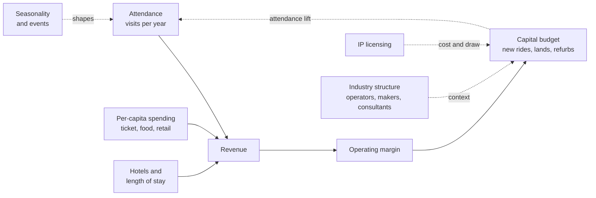

A theme park is a machine for turning capital into visits and visits into cash. The revenue side has three dials. Attendance, counted in the TEA/AECOM Theme Index each year, says how many people came. [Per-capita spending](../operations-business/per-capita-spending.md) says what each one paid for tickets, food and merchandise. [Length of stay](../operations-business/length-of-stay.md), driven by hotels and multi-day tickets, multiplies both at destination resorts.

The cost side is dominated by two things: labour, discussed under park operations, and capital. [Capital budgets](../operations-business/capital-budgets.md) decide which new rides and lands get built, and [ROI and attendance modeling](../operations-business/roi-and-attendance-modeling.md) tries to predict what each one will earn. [Pricing](../operations-business/pricing.md) and [seasonality and events](../operations-business/seasonality-and-events.md) shape the demand curve across the year. [IP licensing economics](../operations-business/ip-licensing-economics.md) governs the cost of borrowing a famous story, and [industry structure](../operations-business/industry-structure.md) maps who the players are.

Designers live inside these numbers. A ride's scope is set in [feasibility and early costing](../design-process/feasibility-and-early-costing.md), trimmed by value engineering, and judged years later by whether attendance moved.

## Explore further
- `aecom-theme-index` — TEA/AECOM Theme Index and Museum Index
- `sec-edgar-disney-10k-filings` — Walt Disney Co 10-K filings (SEC EDGAR)
- `six-flags-investor-relations` — Six Flags Entertainment Corporation Investor Relations
- `openlibrary-walts-revolution` — Walt's Revolution! By the Numbers
