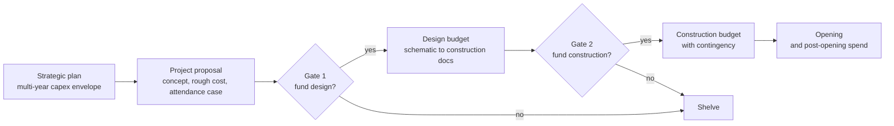

Capital is how parks grow. Day-to-day costs such as wages and electricity come out of the operating budget; new rides, lands, hotels and major refurbishments are capital projects, paid for from a multi-year plan and written off over the asset's life. Public operators disclose these plans: Disney's annual filings and investor presentations describe capital expenditure for its Experiences segment, and regional operators such as Six Flags report capex alongside attendance.

Projects pass through gates. A proposal needs a concept, a rough cost from [feasibility and early costing](../design-process/feasibility-and-early-costing.md), and an attendance case. If approved, a design budget pays for the work from schematic through construction documents; a second gate releases construction money, always with a contingency for surprises. Each gate is a [design review](../design-process/design-reviews-and-gates.md) where scope can be cut, which is where [value engineering](../design-process/scope-and-value-engineering.md) happens.

Timing matters as much as size. Operators spread projects so that one headline opens every year or two, a pattern the [phase timeline](../design-process/phase-timeline.md) and [expansion and phasing](../masterplanning/expansion-and-phasing.md) plans make visible. Published figures for individual rides are rare and usually come from press reports rather than filings, so treat quoted ride costs with caution.

## Explore further
- `sec-edgar-disney-10k-filings` — Walt Disney Co 10-K filings (SEC EDGAR)
- `disney-investor-relations` — The Walt Disney Company Investor Relations
- `six-flags-investor-relations` — Six Flags Entertainment Corporation Investor Relations
