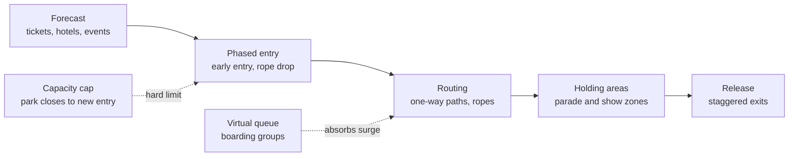

Crowd management is operations at the scale of the whole park. The daily rhythm has four crunch points: the morning rope drop, the parade, the nighttime spectacular, and the exit. Each one concentrates people into a small space in a short time, so ops teams plan them as events with their own staffing, rope lines and one-way routes. Halloween nights add a second crowd on top of the first.

The toolkit is mostly about time and space. Phased entry spreads the morning: resort guests get early entry, then the main gate opens. Posted parade routes and show viewing zones hold thousands of people still in places the master plan reserved for them, see [parade and show crowds](../masterplanning/parade-and-show-crowds.md). Attendance caps and park-closure-to-new-entry rules keep density below a limit. Virtual queues absorb the surge for new rides; when Rise of the Resistance opened in 2019, Disney used boarding groups so the crowd did not form a physical line at all.

Underneath sits human behaviour: herding, [personal space and density](../human-factors/personal-space-and-density.md) and the way people drift toward noise and light, covered in [crowd behavior](../human-factors/crowd-behavior.md). Emergency planning rides on the same routes, which is why [emergency access](../masterplanning/emergency-access.md) is drawn before any parade.

## Explore further
- `disney-virtual-queue-official` — Virtual Queues (Walt Disney World official page)
- `wikipedia-lightning-lane` — Lightning Lane
- `iaapa-research` — IAAPA Research: Benchmark Reports, Outlooks and Economic Impact Studies
