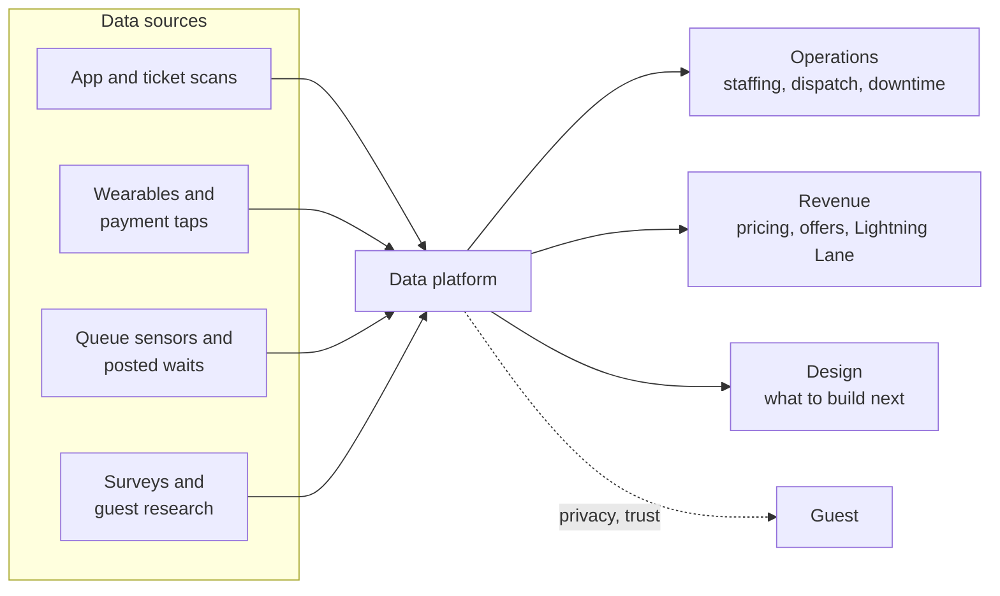

A modern park runs on data. Every ticket scan, app tap, wearable touch and card payment leaves a time-stamped trace, and the queue itself is instrumented with sensors and posted-wait feeds. Operators pool these into platforms that answer the questions this land has been circling: where are the guests, how long are they waiting, what are they buying, and what did they think afterwards.

The four concepts cover the main streams. [Wait-time data and apps](../operations-business/wait-time-data-and-apps.md) look at the official apps and the third-party trackers that mirror them. [Wearables and guest identity](../operations-business/wearables-and-identity.md) covers MagicBand-style devices that tie a person to a room, a ride reservation and a wallet. [Crowd analytics](../operations-business/crowd-analytics.md) is what operators do with the flows, from staffing to simulation. [Guest research](../operations-business/guest-research.md) is the older craft of asking people directly.

The frontier is in the AI land: [wait time prediction](../ai-future/wait-time-prediction.md), [digital twins](../ai-future/digital-twins.md) and [personalization](../ai-future/personalization.md). The limit is trust, covered under [data privacy](../ai-future/data-privacy.md): the same data that smooths a day can feel like surveillance if guests notice.

## Explore further
- `disney-magicband-official` — Disney Bands: MagicBand and MagicBand+ (official page)
- `popsci-touring-plans-wait-time-science-2017` — These data scientists are disrupting Disney World's long wait times
- `queue-times-api` — Queue-Times.com Real Time API
- `milman-2001-future-of-theme-park-industry` — The Future of the Theme Park and Attraction Industry
