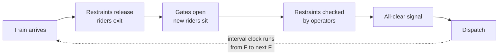

The dispatch interval is the heartbeat of a ride: the time from one departure to the next. It includes everything that happens on the platform, which is why it is often longer than the ride itself is short. A coaster with a 90-second circuit but a 150-second platform routine is limited by the platform, not the track.

The interval is bounded from below by the [block system](../ride-engineering/block-system.md): the next train cannot leave until the one ahead has cleared the first block. On coasters with three trains, the control system stacks a train on the brake run while the station is still loading, and the interval becomes a pure platform problem.

Operators shave seconds with practice. Every added task on the platform, from a second restraint check to a [rider switch](../human-factors/rider-switch.md) handoff, stretches the interval. Formal [dispatch procedures](../safety-standards/dispatch-procedures.md) and well-drilled crews, covered under [ride operations staffing](../operations-business/ride-operations-staffing.md), are therefore capacity tools, not just safety tools. Some parks post a target interval in the booth and track the crew against it.

## Explore further
- `disneyblog-capacity-analysis-methodology` — Capacity Analysis Methodology
- `hersheypark-skyrush-winter-maintenance` — Behind the Scenes of Winter Maintenance on Skyrush
