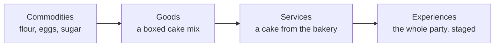

In a July 1998 Harvard Business Review article, B. Joseph Pine II and James H. Gilmore argued that economies climb a ladder of value: commodities, then goods, then services, then experiences. Their example is a child's birthday, once baked from raw ingredients, then from a mix, then bought as a cake, and finally handed to a venue that stages the whole party. Each rung charges more for the same need because it delivers more of what people remember.

Theme parks, which sell little but the visit itself, are the purest case, and the idea now shapes how they invest. A memory, a photo worth sharing or a thing you made yourself outsells a ride count, hence lands built as worlds, see [total-immersion lands](../story-experience/immersive-lands.md), and shops that sell an activity, see [retail as attraction](../operations-business/retail-as-attraction.md). It shows in [per-capita spending](../operations-business/per-capita-spending.md) and in [souvenirs as memory cues](../human-factors/souvenirs-and-memory-cues.md). Wendover Productions ties the shift to social media: a visit that looks unique is one people post, which works as [social proof](../human-factors/herding-and-social-proof.md) for the next visitor.

## Explore further
- `hbr-pine-gilmore-experience-economy-1998` — Welcome to the Experience Economy
- `wendover-how-to-design-a-theme-park` — How to Design a Theme Park (To Take Tons of Your Money)
