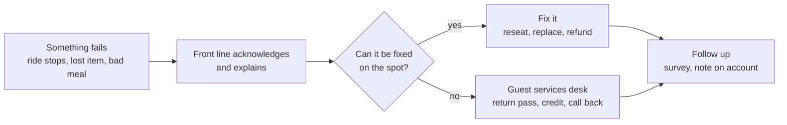

Guest recovery is the operations answer to the fact that things break. A ride stops with the line full, a reservation is lost, a child is too short for the ride the family queued an hour for. The research on service recovery, and the park industry's own practice, says the response matters more than the failure: an explained problem and a fair fix can end the day on a high note, which is exactly what the [peak-end rule](../human-factors/peak-end-rule.md) predicts.

The front line handles most of it. Operators are empowered to reseat a party, hand out a return pass when a ride goes down, or walk a family to another attraction. Explaining the wait is itself a recovery act, see [explained waits](../human-factors/explained-waits.md). Harder cases go to Guest Relations at the front of the park, which can issue credits, rebook dining, or arrange [disability access services](../human-factors/disability-access-services.md).

Operators track recovery because it is cheap relative to a lost repeat visitor. Post-visit surveys, covered under [guest research](../operations-business/guest-research.md), measure how often it works. The specific policies, such as what a return pass covers, differ by company and change often, so this card describes the pattern rather than any one park's rules.

## Explore further
- `maister-psychology-of-waiting-lines` — The Psychology of Waiting Lines
- `disney-virtual-queue-official` — Virtual Queues (Walt Disney World official page)
- `milman-2001-future-of-theme-park-industry` — The Future of the Theme Park and Attraction Industry
