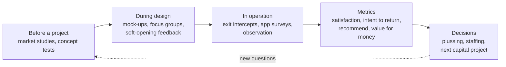

Sensors can tell you where a guest went; only the guest can tell you how it felt. Guest research is the set of methods for asking. The oldest is the market study, the kind Buzz Price pioneered for Disneyland in 1953, which asks who would come and what they would pay. During design, operators test concepts with focus groups and watch real families in mock-ups and [soft openings](../design-process/soft-opening.md). In operation, the staples are the exit intercept, a short interview as guests leave, and app or email surveys the next day.

The questions converge on a few metrics: overall satisfaction, value for money, intent to return and willingness to recommend, often broken down by ride, meal and interaction. Academic work such as Ady Milman's 2001 survey of park managers shows how closely the industry ties these to business outcomes. Because people rate a day from its peaks and ending, survey timing matters, a point from [experiencing vs remembering self](../human-factors/experiencing-vs-remembering-self.md).

Results drive [post-opening plussing](../design-process/post-opening-plussing.md), staffing changes and the case for the next capital project. Third parties run their own panels: Touring Plans uses reader surveys to rate attractions. Operators' internal survey instruments are confidential, so this card describes the practice in general.

## Explore further
- `milman-2001-future-of-theme-park-industry` — The Future of the Theme Park and Attraction Industry
- `openlibrary-walts-revolution` — Walt's Revolution! By the Numbers
- `popsci-touring-plans-wait-time-science-2017` — These data scientists are disrupting Disney World's long wait times
