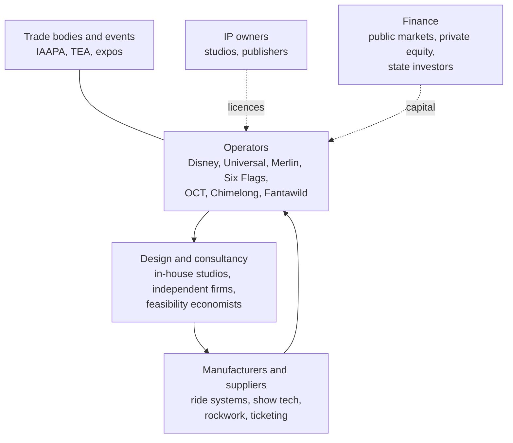

The attractions industry has a recognisable shape. At the centre are operators, the companies that own and run parks: global groups such as Disney and Universal, multi-park chains such as Merlin and Six Flags, and fast-growing Chinese operators such as OCT, Chimelong and Fantawild that now fill the upper rows of the TEA/AECOM attendance tables. Blooloop's landscape report profiles fifteen leading operators and ten emerging players.

Around them sits the supply side. Ride manufacturers, from coaster makers such as Intamin, Mack Rides, Bolliger & Mabillard and Vekoma to dark-ride and motion-base specialists, build the hardware; see [coaster manufacturers](../history/coaster-manufacturers.md). Design happens either in-house, at Walt Disney Imagineering, Universal Creative and [Merlin Magic Making](../history/merlin-magic-making.md), or at independent studios and consultancies that master-plan, theme and cost projects for everyone else. Feasibility economists, descendants of Buzz Price's firm, sit at the front end.

Trade bodies knit it together. IAAPA runs the big expos and publishes benchmarking research; the Themed Entertainment Association gives the Thea Awards and co-publishes the Theme Index. Their events, covered under [conferences](../careers/conferences.md) and [professional bodies](../careers/professional-bodies.md), are where operators, makers and designers meet. The [Asian expansion](../history/asian-expansion.md) of the last two decades has reshaped every layer of this map.

## Explore further
- `blooloop-eca-global-attraction-landscape` — ECA-blooloop Global Attraction Landscape Report v1.0
- `blooloop-supplier-directory` — blooloop supplier directory
- `aecom-theme-index` — TEA/AECOM Theme Index and Museum Index
- `iaapa-research` — IAAPA Research: Benchmark Reports, Outlooks and Economic Impact Studies
