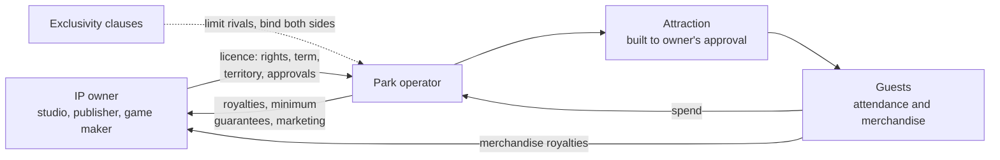

A famous story is the surest way to fill a new land, and the costliest. Unless the operator owns the brand, as Disney does with Pixar and Marvel films, it licenses it: a contract granting rights to build attractions and sell merchandise, in return for royalties, minimum guarantees and the owner's approval over every design. Universal's parks are the clearest case, built largely on licensed worlds such as Harry Potter and Nintendo; see [IP adaptation](../story-experience/ip-adaptation.md) for the creative side.

The contracts last. On March 22, 1994, Universal's parent MCA signed a theme-park licence for Marvel characters that still governs who may use Spider-Man, the Avengers and the X-Men in U.S. parks: Walt Disney World cannot, Disneyland west of the Mississippi largely can, and the "Marvel" name itself stays off Disney's U.S. parks. Disney bought Marvel in 2009 and honours the deal. Universal's Nintendo partnership, announced in May 2015, produced Super Nintendo World in Japan in 2021, Hollywood in 2023 and Orlando in 2025.

A licence trades upside for certainty: the owner takes a share, demands approvals that slow design, and can decline to renew, which constrains future [retheming](../operations-business/retheming-and-overlays.md). The resulting arms race is the subject of [IP wars](../history/ip-wars.md).

## Explore further
- `wikipedia-marvel-super-hero-island` — Marvel Super Hero Island
- `wikipedia-super-nintendo-world` — Super Nintendo World
- `blooloop-eca-global-attraction-landscape` — ECA-blooloop Global Attraction Landscape Report v1.0
