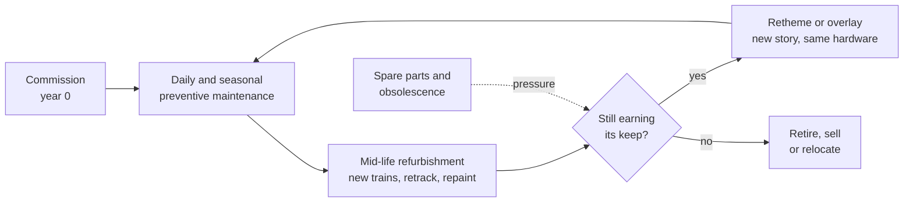

Maintenance and lifecycle is the long game of park operations. On opening day a ride is new and reliable; from then on it is a machine wearing out under millions of load cycles, weather and sun. Keeping it safe and available is the job of [preventive maintenance](../operations-business/preventive-maintenance.md), the daily checks and off-season teardowns that catch wear before it becomes a failure.

Over decades the questions change. The [ride lifecycle](../operations-business/ride-lifecycle.md) runs from commissioning through mid-life refurbishment, when trains, track sections, control systems and show scenes are renewed. A [retheme or overlay](../operations-business/retheming-and-overlays.md) can give old hardware a new story at a fraction of the cost of a new ride. Eventually [retirement and relocation](../operations-business/retirement-and-relocation.md) decide whether the ride is scrapped, sold or moved to another park. All the while [spare parts and obsolescence](../operations-business/spare-parts-and-obsolescence.md) make old rides harder to keep alive.

Designers shape every stage. Choices about materials, the [fatigue](../ride-engineering/fatigue.md) life of structures, access for inspection and the reliability of show figures set the maintenance bill for thirty years, which is why operators read drawings with the night shift in mind.

## Explore further
- `hersheypark-skyrush-winter-maintenance` — Behind the Scenes of Winter Maintenance on Skyrush
- `ptc-roller-coaster-car-winter-maintenance` — Roller Coaster Car Winter Maintenance
- `wikipedia-phoenix-roller-coaster` — Phoenix (roller coaster)
