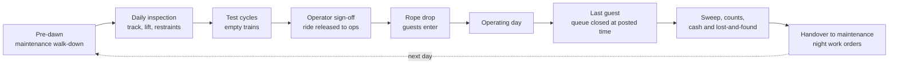

A theme park day begins hours before the gates open. At Hersheypark, two team members start inspecting the Skyrush coaster at about 5 a.m. and take roughly five hours: one checks track pillars and bolts, the other walks the lift hill, and then the ride runs manufacturer-specified test cycles before anyone is allowed on. Most parks follow the same shape: a maintenance walk-down, a daily [inspection](../safety-standards/inspections.md) against a written checklist, empty test runs, and a sign-off that formally hands the ride from maintenance to operations.

Rope drop is the guest-facing moment. Parks stage people at the gate and then at a rope inside the [entry sequence](../masterplanning/entry-sequence.md), releasing them in a controlled walk so the first surge to the headline ride does not become a run. Resort guests often get an early-entry window first.

Closing runs in reverse. The queue is cut at the posted close, the last riders cycle through, cast members sweep every area, cash and attendance counts are reconciled, and the park is handed to the night shift for cleaning and [preventive maintenance](../operations-business/preventive-maintenance.md). Written procedures for all of this are part of what the U.S. ASTM F770 practice expects of an operator; see [ASTM F770](../safety-standards/astm-f770.md).

## Explore further
- `hersheypark-skyrush-winter-maintenance` — Behind the Scenes of Winter Maintenance on Skyrush
- `iaapa-research` — IAAPA Research: Benchmark Reports, Outlooks and Economic Impact Studies
- `maister-psychology-of-waiting-lines` — The Psychology of Waiting Lines
