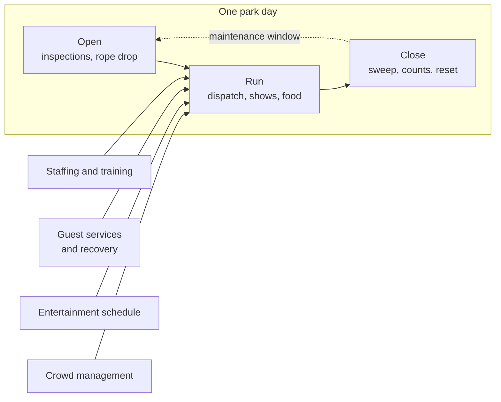

Park operations is everything that happens after the designers leave. The rides, sets and scripts are fixed; what varies day to day is the people running them, the crowd that shows up, and the weather. Operations is the discipline of turning a static design into a repeatable, safe, friendly day, thousands of times a year.

The pieces are concrete. [Ride operations staffing](../operations-business/ride-operations-staffing.md) puts trained crews on platforms. [Cast and guest interaction](../operations-business/service-culture.md) sets the tone of every encounter. [Crowd management](../operations-business/crowd-management.md) and [entertainment scheduling](../operations-business/entertainment-scheduling.md) move people through the park and around its bottlenecks. [Guest recovery](../operations-business/guest-recovery.md) fixes the day when something goes wrong, and [opening and closing procedures](../operations-business/opening-and-closing-procedures.md) bracket it all with inspections and resets.

For designers, operations is a client. A set that cannot be cleaned, a queue that cannot be cut short, or a show that needs five technicians will be quietly changed by the people who run it. Design with the [onstage and backstage](../masterplanning/onstage-backstage.md) split in mind, and remember that ops managers, not Imagineers, decide how a ride is actually run.

## Explore further
- `maister-psychology-of-waiting-lines` — The Psychology of Waiting Lines
- `iaapa-research` — IAAPA Research: Benchmark Reports, Outlooks and Economic Impact Studies
- `milman-2001-future-of-theme-park-industry` — The Future of the Theme Park and Attraction Industry
