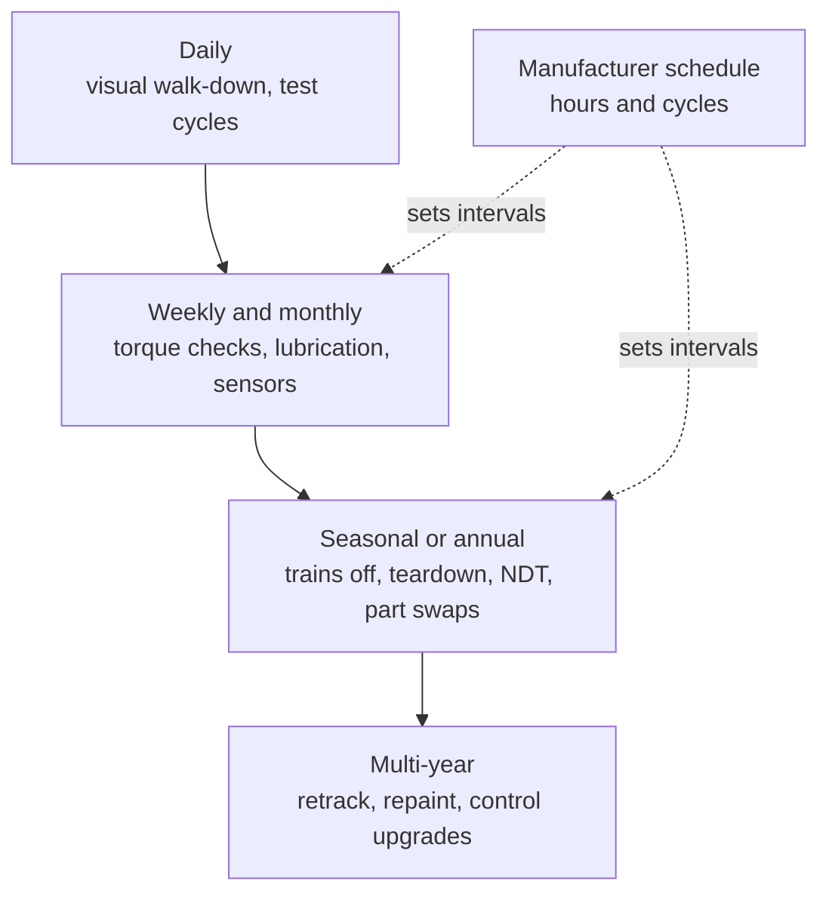

```vega-lite
{
  "$schema": "https://vega.github.io/schema/vega-lite/v5.json",
  "title": "Illustrative: a winter teardown calendar for a seasonal coaster",
  "width": 300, "height": 110,
  "data": {"values": [
    {"task": "Trains craned off", "start": "2025-11-15", "end": "2025-11-25"},
    {"task": "Teardown and NDT", "start": "2025-11-25", "end": "2026-02-01"},
    {"task": "Rebuild and part swaps", "start": "2026-02-01", "end": "2026-03-10"},
    {"task": "Trains back, test cycles", "start": "2026-03-10", "end": "2026-04-01"}
  ]},
  "mark": "bar",
  "encoding": {
    "y": {"field": "task", "type": "nominal", "title": null, "sort": null},
    "x": {"field": "start", "type": "temporal", "title": "Off-season"},
    "x2": {"field": "end"}
  }
}
```

Preventive maintenance means fixing things on a calendar, not when they break. Every ride ships with a manufacturer schedule that says which parts to inspect or replace after so many hours or cycles: wheels, bearings, restraint pins, brake fins, lift chain links. The park's maintenance team turns that into daily, weekly, seasonal and multi-year routines.

A seasonal park shows the pattern clearly. At Hersheypark the Skyrush coaster's trains are craned off the track in mid-November, stripped to components, cleaned, sent for non-destructive testing, and rebuilt with new parts, such as brass for the kingpins and bogies, before going back in mid-March for test cycles. Philadelphia Toboggan Coasters runs a similar programme in its own factory for wooden-coaster cars. Year-round parks cannot stop for months, so they rotate spare trains and close one ride at a time.

The payoff is availability. Parts replaced on schedule rarely fail in service, so [downtime](../operations-business/downtime-and-availability.md) falls. The cost is replacing parts with life still in them, which is what sensor-driven [predictive maintenance](../ai-future/predictive-maintenance.md) tries to avoid. In the U.S. the ASTM F770 practice sets owner duties for maintenance and [inspections](../safety-standards/inspections.md); see also [wheels and bogies](../ride-engineering/wheels-and-bogies.md), the most consumed parts of all.

## Explore further
- `hersheypark-skyrush-winter-maintenance` — Behind the Scenes of Winter Maintenance on Skyrush
- `ptc-roller-coaster-car-winter-maintenance` — Roller Coaster Car Winter Maintenance
- `blogmickey-wsj-ride-downtime-2022` — Disney says ride reliability remains strong despite reported increase in downtime
