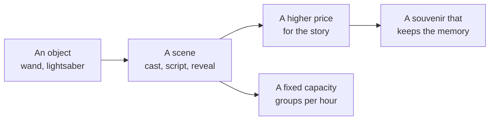

Retail as attraction turns buying something into a scene with a cast, a script and a reveal, so the purchase is the experience. It is how a land sells the personal, hard-to-scale moments people value most.

At Ollivanders in Hogsmeade, a group of about 20 watches a wandkeeper try wands on one guest until one "chooses" them, with small effects as the wrong ones misfire. In Diagon Alley, interactive wands trigger effects around the land, so the souvenir keeps working after it is bought; see [souvenirs as memory cues](../human-factors/souvenirs-and-memory-cues.md). At Galaxy's Edge, Savi's Workshop builds a lightsaber in a short ceremony; at its May 2019 opening the handbuilt saber cost $199 plus tax.

The business case is higher [per-capita spending](../operations-business/per-capita-spending.md) without a new ride. The catch is that a scene has fixed capacity, unlike a ride's [throughput](../operations-business/throughput-math.md), so demand has to be managed with queues or bookings. It depends on performers trained in [cast role-play](../story-experience/cast-role-play.md), and on [food and retail placement](../masterplanning/food-and-retail-placement.md) that keeps the shop inside the story's path.

## Explore further
- `wikipedia-wizarding-world-orlando` — The Wizarding World of Harry Potter (Universal Orlando)
- `blogmickey-savis-lightsaber-pricing-2019` — Handbuilt Lightsaber Pricing Revealed for Savi's Workshop in Star Wars: Galaxy's Edge
- `wendover-how-to-design-a-theme-park` — How to Design a Theme Park (To Take Tons of Your Money)
