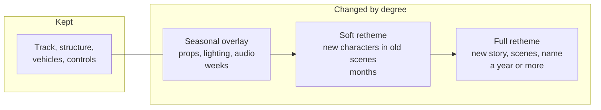

A retheme changes what a ride is about without changing what it does. The expensive parts of an attraction, the track, structure, ride system and control hardware, stay where they are; the scenes, figures, audio, queue and name are replaced. Because the ride system is already permitted and paid for, a retheme delivers a "new" attraction for a fraction of a new build's cost.

Overlays are the lightest version. A seasonal overlay swaps props, lighting and soundtrack for a holiday season and swaps them back; the Haunted Mansion's Nightmare Before Christmas holiday version at Disneyland is the best-known example, covered under [seasonal overlays](../sensory-environment/seasonal-overlays.md). A soft retheme places new characters into existing scenes. A full retheme rebuilds the story from the ground up: Splash Mountain at Walt Disney World closed on January 23, 2023 and reopened as Tiana's Bayou Adventure on June 28, 2024, on the same flume.

The usual drivers are an aged brand, an [IP adaptation](../story-experience/ip-adaptation.md) opportunity, a licence ending, or the need for a headline between capital projects. A layout built for one story carries its pacing into the new one, so the best rethemes pick rides whose beats already fit the [ride beat sheet](../story-experience/ride-beat-sheet.md).

## Explore further
- `wikipedia-tianas-bayou-adventure` — Tiana's Bayou Adventure
- `wikipedia-marvel-super-hero-island` — Marvel Super Hero Island
- `aecom-theme-index` — TEA/AECOM Theme Index and Museum Index
