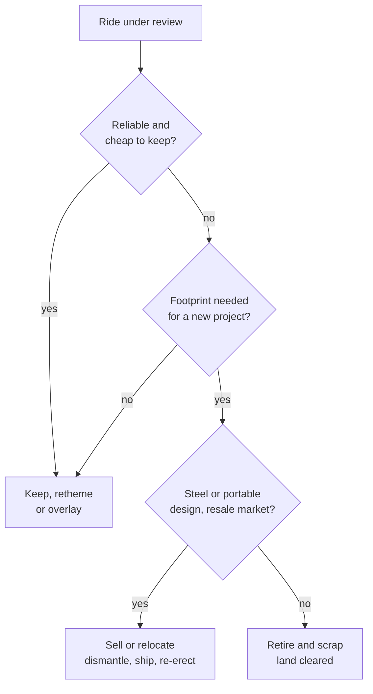

Every ride eventually stops earning its footprint. Attendance drifts to newer attractions, parts get scarce, or the land is simply worth more as the site of the next big project. The operator then chooses among three endings: retire and scrap, sell to another park, or relocate within the company. Fan nostalgia weighs heavily, which is why closures are announced carefully and farewell events sell merchandise.

Relocation is more common than guests realise. Steel coasters are bolted together and can be unbolted; a used-ride market, with brokers and manufacturers listed in trade directories, moves them between parks and continents. Wooden coasters are harder but not impossible: the Phoenix at Knoebels in Pennsylvania opened in 1947 as the Rocket at Playland Park in San Antonio, was bought in 1984, dismantled in 1985 and rebuilt the same year, and still runs today. Relocated rides often reopen under new names and themes, so relocation and [retheming](../operations-business/retheming-and-overlays.md) travel together.

Retirement feeds [expansion and phasing](../masterplanning/expansion-and-phasing.md): clearing an old flat ride is how a mature park finds room. When a whole park closes, its rides scatter across the industry, a story told in [defunct parks](../history/defunct-parks.md). Retired [wooden coasters](../ride-systems/wooden-coasters.md) are usually demolished; their structure has little resale value.

## Explore further
- `wikipedia-phoenix-roller-coaster` — Phoenix (roller coaster)
- `aecom-theme-index` — TEA/AECOM Theme Index and Museum Index
- `blooloop-supplier-directory` — blooloop supplier directory
