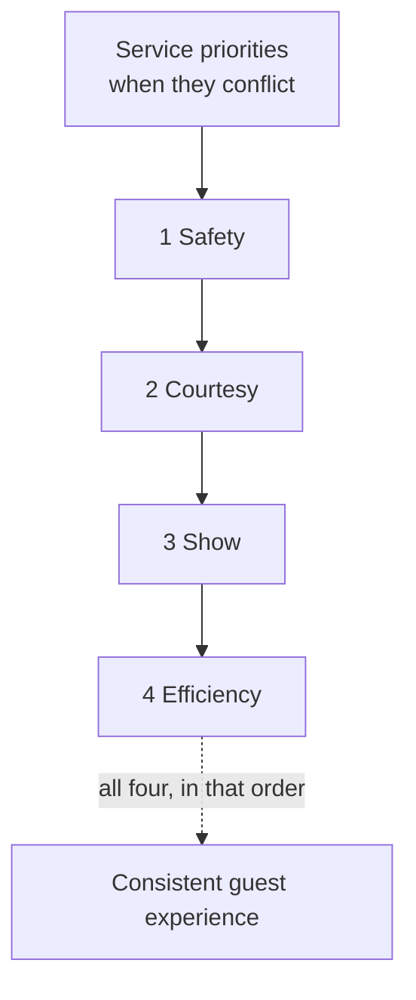

The theatre metaphor runs deep in park operations. Disney calls employees cast members, uniforms costumes, and public areas on stage; Universal uses team members. The vocabulary is a training device: it reminds a ride host that scanning a ticket is a performance. Many operators teach an ordered set of priorities, safety first, then courtesy, then show, then efficiency, so a new employee knows what to do when two goals collide.

The reason this matters is contagion. A host who is bored makes the queue feel longer; one who plays with the line makes it feel shorter, which is Maister's "occupied time" rule applied by a human. Because guests remember ends and peaks, the unload host saying goodbye may count more than the pre-show, a point from the [peak-end rule](../human-factors/peak-end-rule.md).

For designers the lesson is to write staff into the experience. Give the host a line, a prop or a role, as the scare actors and ride ops at Universal's Halloween events do, and see [cast role-play](../story-experience/cast-role-play.md). Keep the [onstage and backstage](../masterplanning/onstage-backstage.md) boundary clear so breaks and deliveries stay invisible. The exact wording of priority lists varies by company and is not confirmed here from a primary source.

## Explore further
- `maister-psychology-of-waiting-lines` — The Psychology of Waiting Lines
- `milman-2001-future-of-theme-park-industry` — The Future of the Theme Park and Attraction Industry
- `openlibrary-walts-revolution` — Walt's Revolution! By the Numbers
