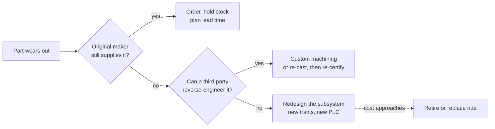

A ride is only as alive as its supply chain. Wheels, bearings, pins and brake pads are consumed every season, so parks hold stock against manufacturer lead times. The deeper problem is obsolescence: parts nobody makes any more. Ride manufacturers merge or go out of business, a famous case being Arrow Dynamics, whose bankruptcy left many parks maintaining Arrow coasters without the original supplier; see [Arrow Dynamics](../history/arrow-dynamics.md). Control hardware ages faster still, because industrial controllers and sensors are discontinued on electronics timescales.

Operators have a ladder of responses. First, over-order while the part is available. Second, find a specialist to reverse-engineer it, as several firms now do for orphaned coaster trains, after which the part must be re-certified. Third, redesign the subsystem: replacing an entire train fleet or control system is common mid-life work, which is why [ride control systems](../safety-standards/ride-control-systems.md) get upgraded even when the track is fine. When redesign costs approach a new ride, the [ride lifecycle](../operations-business/ride-lifecycle.md) ends.

Show hardware has the same problem with projectors, media servers and animatronic actuators, see [figure reliability](../show-technology/figure-reliability.md). Designers help by specifying standard industrial components; parks' exact stocking practices are proprietary and not confirmed here.

## Explore further
- `ptc-roller-coaster-car-winter-maintenance` — Roller Coaster Car Winter Maintenance
- `hersheypark-skyrush-winter-maintenance` — Behind the Scenes of Winter Maintenance on Skyrush
- `blooloop-supplier-directory` — blooloop supplier directory
