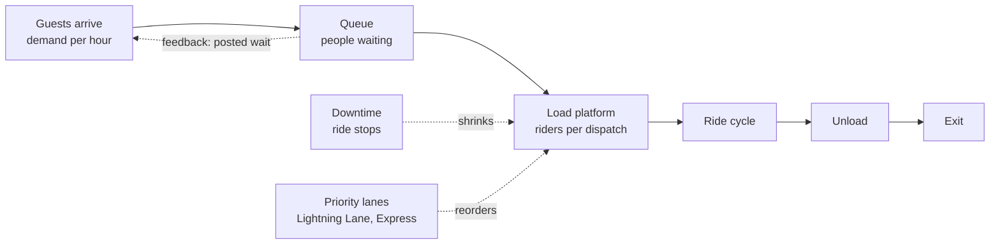

Throughput and queueing is the engine room of park operations. A ride is a service point: people arrive at some rate, the ride serves them at some rate, and whatever the ride cannot absorb piles up as a line. The [throughput math](../operations-business/throughput-math.md) is simple multiplication, but it sets the hard ceiling on how many guests a park can make happy each day.

The super-concept has five parts. Throughput math and [queueing theory](../operations-business/queueing-theory.md) explain where waits come from. [Wait time estimation](../operations-business/wait-time-estimation.md) covers how parks measure and post them. [Downtime and availability](../operations-business/downtime-and-availability.md) covers what happens when the ride stops. [Capacity vs demand](../operations-business/capacity-vs-demand.md) joins the two curves over a day.

Why a designer should care: the same hourly capacity is decided in the [load area](../story-experience/load-as-story.md), in the vehicle count, and in the master plan's [capacity planning](../masterplanning/capacity-planning.md). A beautiful ride that dispatches slowly will spend its life with a two-hour line.

## Explore further
- `little-1961-queuing-formula` — A Proof for the Queuing Formula: L = λW
- `maister-psychology-of-waiting-lines` — The Psychology of Waiting Lines
- `disneyblog-capacity-analysis-methodology` — Capacity Analysis Methodology
