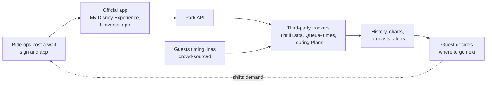

Posted waits used to live on a sign at the ride entrance. Now they live in the park's app, and because the app reads them from an API, anyone can read them too. Independent trackers do exactly that. Thrill Data has pulled wait times from Disney's app since 2019; Queue-Times.com publishes a free JSON feed for more than 80 parks, refreshed every five minutes; Touring Plans combines the posted numbers with timings its Lines app users report while standing in line.

The stored history is more valuable than any single number. Years of five-minute snapshots show how each ride's wait moves through a day and when it stops. Journalists used that archive to analyse ride stoppages in 2022, and forecasters use it for the models described in [wait time prediction](../ai-future/wait-time-prediction.md). Guests get a map of the crowd, which is also a dose of [decision fatigue](../human-factors/decision-fatigue.md) when every choice is a number.

For operators the app is a control panel. A posted wait is a message as much as a measurement, see [wait time estimation](../operations-business/wait-time-estimation.md), and the same app hosts [virtual queues](../human-factors/virtual-queues.md) and Lightning Lane booking. For developers the public feeds are the easiest way into [crowd analytics](../operations-business/crowd-analytics.md).

## Explore further
- `queue-times-api` — Queue-Times.com Real Time API
- `input-wait-time-trackers-2022` — The amateur data scientists tracking Disney World's lines
- `popsci-touring-plans-wait-time-science-2017` — These data scientists are disrupting Disney World's long wait times
- `touringplans-home` — Touring Plans
