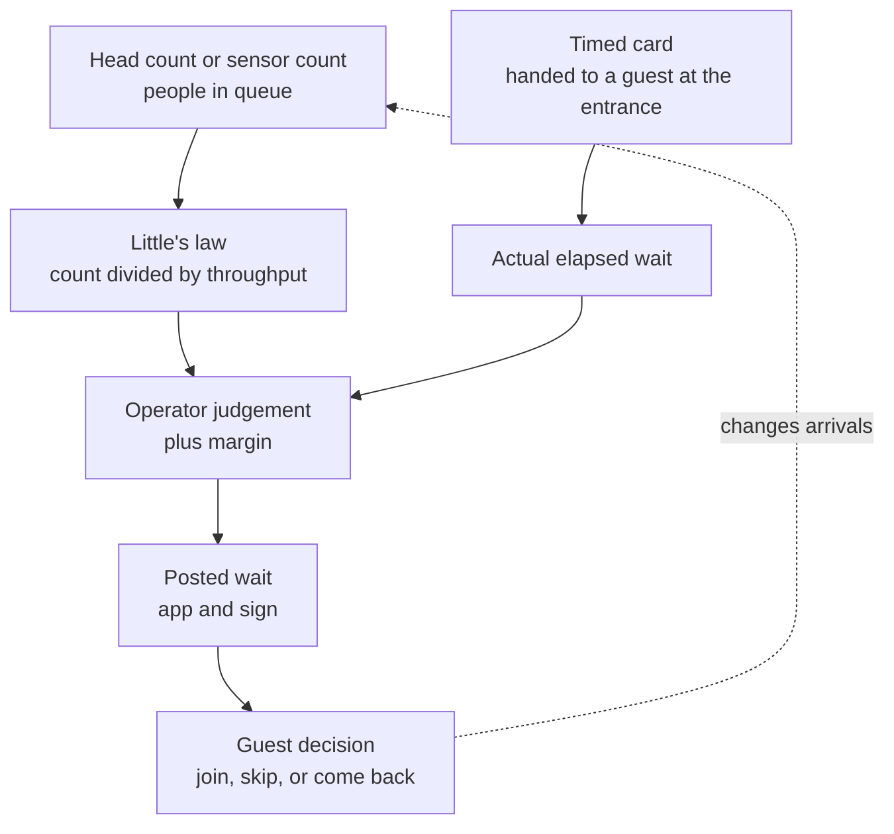

A posted wait is an estimate, not a measurement. The classic method is the timed card: a cast member hands a laminated card to a guest entering the line, and the time it takes to reach the merge point becomes the posted number. A faster method uses [Little's law](../operations-business/littles-law.md): count the people in the switchbacks and divide by the ride's throughput. Modern parks add sensors, app pings and wearable scans to automate the count.

Parks then round. Independent trackers have found that posted times at Disney tend to run higher than actual waits most of the time. Len Testa of Touring Plans has said that for some rides Disney's posted times are overestimated about three-quarters of the time and underestimated about a quarter. A high posting steers guests elsewhere, which is useful for crowd balancing, and it makes the real wait feel like a pleasant surprise, a point that pairs with [perceived vs actual wait](../human-factors/perceived-vs-actual-wait.md).

Third-party services such as Touring Plans and Thrill Data collect posted numbers every few minutes and compare them with crowd-sourced timings. Their forecasts feed [wait-time apps](../operations-business/wait-time-data-and-apps.md) and the machine-learning methods described under [wait time prediction](../ai-future/wait-time-prediction.md).

## Explore further
- `popsci-touring-plans-wait-time-science-2017` — These data scientists are disrupting Disney World's long wait times
- `input-wait-time-trackers-2022` — The amateur data scientists tracking Disney World's lines
- `wikipedia-littles-law` — Little's law
