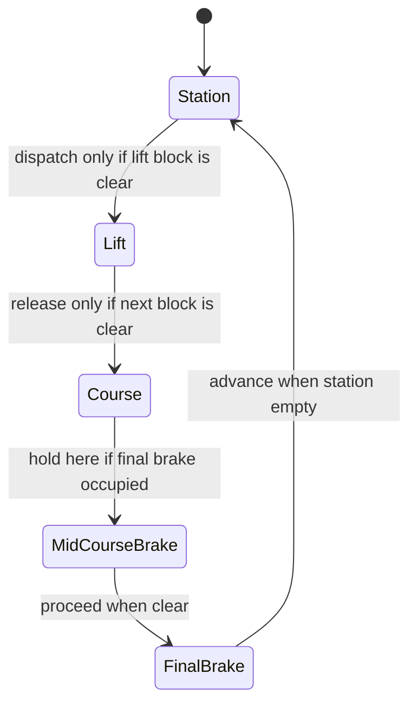

Railways solved collisions in the nineteenth century by dividing the line into blocks and allowing only one train in each. Coasters borrowed the rule directly. Each block has a controllable entry and a way to stop a train inside it: a station, a lift whose chain can halt, a mid-course brake run, a final brake. A train may enter only when the next block is confirmed empty, so if a train stalls the one behind is held upstream. Coaster101's rule of thumb follows: a ride needs at least one more block than it has trains.

The controller is a programmable logic controller fed by proximity sensors; when a block is unexpectedly occupied it holds, which riders feel as a pause on the brakes. Being stopped mid-course is the system working. Because such brakes interrupt pacing, Mack Rides hid Voltron Nevera's block zone in a valley and lets up to seven trains circulate.

Blocks also cap capacity: the slowest block sets the minimum [dispatch interval](../operations-business/dispatch-interval.md) in any [throughput calculation](../operations-business/throughput-math.md). Disney's Space Mountain, opened in 1975, was among the first coasters to run this logic by computer, and the rules now live inside [ride control systems](../safety-standards/ride-control-systems.md) alongside [emergency stop and evacuation](../safety-standards/emergency-stop-and-evacuation.md) procedures.

## Explore further
- `coaster101-brakes-blocks-sensors` — Coasters-101: Brakes, Blocks, and Sensors
- `coaster101-voltron-tech` — The Tech Behind Voltron Nevera
- `wikipedia-roller-coaster-safety` — Roller coaster (mechanics and safety sections)
