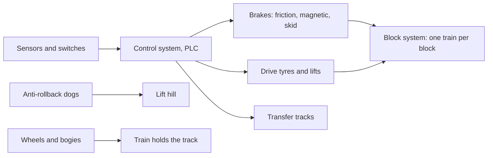

Gravity does the exciting part of a coaster; this hardware does the responsible part. Its job is to know where every train is, keep trains apart, and be able to stop or hold any of them at any moment, even with the power off. The organising idea is the [block system](../ride-engineering/block-system.md): the track is cut into sections and only one train may be in each.

To make that promise real, a controller needs eyes and hands. The eyes are [sensors and switches](../ride-engineering/sensors-and-switches.md), mostly inductive proximity switches counting metal flags under the cars. The hands are [brake types](../ride-engineering/brake-types.md) from old skid plates to magnetic fins, plus [drive tyres and transfer tracks](../ride-engineering/drive-tires-and-transfer-tracks.md) that move trains at low speed and park them. On the lift, [anti-rollback](../ride-engineering/anti-rollback.md) dogs hold the train if the chain lets go, and underneath everything the [wheels and bogies](../ride-engineering/wheels-and-bogies.md) keep the train clamped to the rail. The logic that ties it together lives in [ride control systems](../safety-standards/ride-control-systems.md) and is judged by [redundancy and fail-safe](../safety-standards/redundancy-and-fail-safe.md) rules; the number of blocks also caps how many trains run, and so the [dispatch interval](../operations-business/dispatch-interval.md).

## Explore further
- `coaster101-brakes-blocks-sensors` — Coasters-101: Brakes, Blocks, and Sensors
- `wikipedia-brake-run` — Brake run
- `wikipedia-roller-coaster-safety` — Roller coaster (mechanics and safety sections)
